Cours complet · de zéro à l'architecture

# Les réseaux informatiques, de A à Z

Dix-huit chapitres pour comprendre comment deux machines se parlent : câbles, adresses, routage, protocoles, Wi-Fi, sécurité, cloud et dépannage. Chaque chapitre contient des schémas et des tableaux de référence. Lis-les dans l'ordre : chacun s'appuie sur le précédent.

Sommaire

1. [00 Vue d'ensemble](#c0)
2. [01 Fondamentaux](#c1)
3. [02 Modèles OSI et TCP/IP](#c2)
4. [03 Couche physique](#c3)
5. [04 Ethernet, switch, VLAN](#c4)
6. [05 Adressage IPv4](#c5)
7. [06 IPv6](#c6)
8. [07 Routage et NAT](#c7)
9. [08 Transport : TCP et UDP](#c8)
10. [09 DNS et DHCP](#c9)
11. [10 Web, HTTP, TLS](#c10)
12. [11 Autres services](#c11)
13. [12 Équipements](#c12)
14. [13 Wi-Fi et mobile](#c13)
15. [14 Sécurité](#c14)
16. [15 Architecture](#c15)
17. [16 Cloud, SDN, SD-WAN](#c16)
18. [17 Supervision, dépannage](#c17)
19. [18 Parcours et glossaire](#c18)

## 00 Vue d'ensemble

Un réseau est un ensemble d'appareils reliés pour échanger des données selon des règles communes appelées **protocoles**. Tout le cours répond à une seule question : comment un message part d'une application sur une machine, traverse des câbles, des commutateurs et des routeurs, et arrive à la bonne application sur une autre machine.

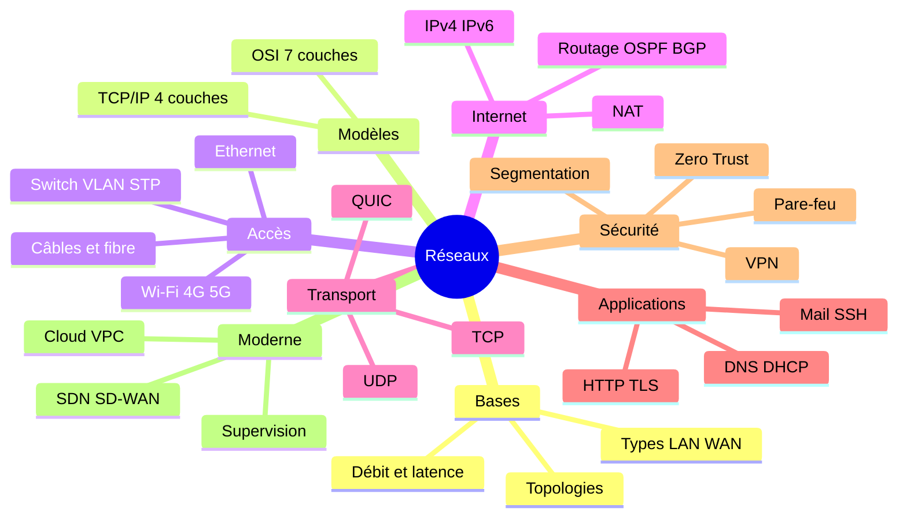

Carte du cours : les six grands blocs et leurs notions.

### Ce que tu sauras faire à la fin

- Lire et construire un plan d'adressage, découper un réseau en sous-réseaux.
- Expliquer ce qui se passe quand on tape une adresse dans un navigateur.
- Configurer le raisonnement d'un switch, d'un routeur, d'un pare-feu.
- Diagnostiquer une panne avec une méthode, couche par couche.
- Sécuriser un réseau et comprendre les architectures actuelles, cloud compris.

## 01 Fondamentaux

### Les types de réseaux par taille

| Type | Portée | Exemple | Technologies typiques |
| --- | --- | --- | --- |
| PAN | quelques mètres | Casque Bluetooth, montre connectée | Bluetooth, NFC, Zigbee |
| LAN | une pièce à un bâtiment | Réseau d'une maison, d'un bureau | Ethernet, Wi-Fi |
| MAN | une ville ou un campus | Réseau d'une métropole | Fibre, Metro Ethernet |
| WAN | pays, monde | Liaison entre deux sites, Internet | MPLS, fibre opérateur, SD-WAN, 4G/5G |
| SAN | baie de stockage | Serveurs reliés à un stockage | Fibre Channel, iSCSI, NVMe-oF |

### Intranet, extranet, Internet

- **Internet** : réseau mondial public de réseaux interconnectés.
- **Intranet** : réseau privé d'une organisation, réservé à ses membres.
- **Extranet** : partie d'un intranet ouverte à des partenaires ou clients.

### Topologies

La topologie décrit la forme du réseau. Elle peut être **physique** (où passent les câbles) ou **logique** (comment les données circulent). Aujourd'hui, le LAN filaire est presque toujours en étoile, et les datacenters en spine-leaf (chapitre 15).

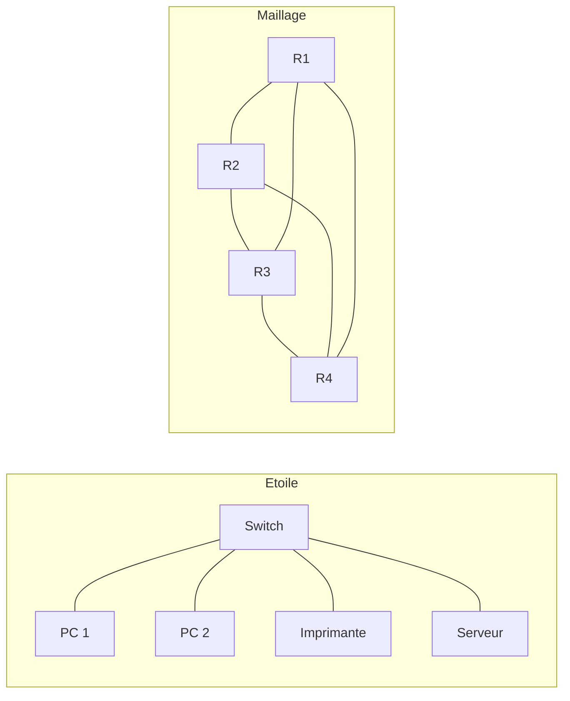

Étoile (un point central) et maillage complet (plusieurs chemins).

| Topologie | Principe | Avantage | Limite |
| --- | --- | --- | --- |
| Bus | Un câble commun | Peu de câble | Une coupure arrête tout, obsolète |
| Anneau | Chaque nœud relié à ses deux voisins | Accès régulé | Une panne peut casser la boucle |
| Étoile | Tout converge vers un switch | Simple, une panne n'affecte qu'un lien | Le switch central est un point unique de panne |
| Arbre / hiérarchique | Étoiles reliées entre elles | Extensible | Dépend des liens montants |
| Maillage | Liens multiples entre nœuds | Redondance maximale | Coûteux, complexe |

### Modèles de communication

- **Client-serveur** : un client demande, un serveur répond (web, mail, base de données).
- **Pair à pair (P2P)** : chaque machine est à la fois client et serveur (BitTorrent, certaines visios).

Autre distinction : un message peut être envoyé en **unicast** (un destinataire), **broadcast** (tous les appareils du segment), **multicast** (un groupe abonné) ou **anycast** (le plus proche d'un groupe de serveurs identiques, utilisé par le DNS et les CDN).

### Commutation de circuits et de paquets

Le téléphone historique réservait un circuit dédié pour toute la durée de l'appel. Internet fonctionne en **commutation de paquets** : les données sont découpées en petits paquets qui voyagent indépendamment, chaque routeur choisissant le prochain saut. On partage ainsi mieux les liens, au prix d'une latence variable.

### Mesurer un réseau

| Grandeur | Définition | Unité |
| --- | --- | --- |
| Bande passante | Capacité maximale théorique du lien | bit/s (Mb/s, Gb/s) |
| Débit (throughput) | Quantité réellement transférée par seconde | bit/s |
| Goodput | Débit utile, sans les en-têtes ni les retransmissions | bit/s |
| Latence | Temps d'aller simple d'un paquet | ms |
| RTT | Temps d'aller-retour (ce que mesure `ping`) | ms |
| Gigue (jitter) | Variation de la latence | ms |
| Perte de paquets | Pourcentage de paquets qui n'arrivent pas | % |

Piège classique

Les débits se comptent en **bits** (Mb/s) et les fichiers en **octets** (Mo). 1 octet = 8 bits. Une ligne à 100 Mb/s transfère au mieux 12,5 Mo/s.

Autre repère : la lumière met environ 5 ms pour parcourir 1 000 km de fibre. Une latence ne descendra donc jamais sous cette limite physique, quel que soit le matériel.

## 02 Modèles OSI et TCP/IP

Un modèle en couches découpe un problème complexe en étapes. Chaque couche rend un service à celle du dessus et utilise celle du dessous, sans connaître les détails. Le modèle **OSI** (7 couches) sert de langage commun et de grille de dépannage. Le modèle **TCP/IP** (4 couches) décrit ce qui est réellement utilisé.

| N° | Couche OSI | Rôle | Unité (PDU) | Exemples | TCP/IP |
| --- | --- | --- | --- | --- | --- |
| 7 | Application | Services offerts aux programmes | Données | HTTP, DNS, SMTP, SSH | Application |
| 6 | Présentation | Format, chiffrement, compression | Données | TLS, JSON, JPEG |  |
| 5 | Session | Ouvrir, maintenir, fermer un dialogue | Données | Sessions RPC, NetBIOS |  |
| 4 | Transport | Communication de bout en bout, ports | Segment (TCP) / Datagramme (UDP) | TCP, UDP, QUIC | Transport |
| 3 | Réseau | Adressage logique, routage | Paquet | IP, ICMP, OSPF | Internet |
| 2 | Liaison de données | Adressage physique, accès au média | Trame | Ethernet, Wi-Fi, ARP, VLAN | Accès réseau |
| 1 | Physique | Transmission des bits (signal) | Bit | Câble, fibre, radio |  |

Moyen mnémotechnique, de la couche 7 à 1 : **A**ucun **P**etit **S**inge **T**ape **R**apidement **L**es **P**ommes (Application, Présentation, Session, Transport, Réseau, Liaison, Physique).

### L'encapsulation

À l'envoi, chaque couche ajoute son en-tête (parfois une fin) autour des données reçues de la couche supérieure. À la réception, chaque couche retire le sien : c'est la désencapsulation.

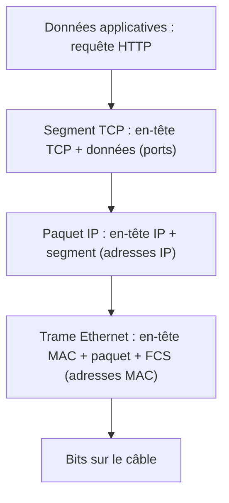

Encapsulation à l'émission, de l'application vers le câble.

À retenir

- Un **switch** travaille en couche 2 (adresses MAC), un **routeur** en couche 3 (adresses IP).
- Les adresses MAC changent à chaque saut. Les adresses IP source et destination restent les mêmes de bout en bout (hors NAT).
- Le dépannage suit l'ordre : couche 1, puis 2, puis 3, puis les couches hautes.

## 03 Couche physique

La couche 1 transporte des bits sous forme de signaux électriques (cuivre), lumineux (fibre) ou radio (Wi-Fi). Elle fixe la distance, le débit et la sensibilité aux interférences.

### Câbles en cuivre à paires torsadées

| Catégorie | Fréquence | Débit usuel | Distance max. |
| --- | --- | --- | --- |
| Cat 5e | 100 MHz | 1 Gb/s | 100 m |
| Cat 6 | 250 MHz | 1 Gb/s (10 Gb/s jusqu'à 55 m) | 100 m |
| Cat 6A | 500 MHz | 10 Gb/s | 100 m |
| Cat 7 / 7A | 600 / 1 000 MHz | 10 Gb/s | 100 m |
| Cat 8 | 2 000 MHz | 25 ou 40 Gb/s | 30 m (datacenter) |

- **UTP** non blindé, **FTP / STP** avec écran, **S/FTP** avec blindage par paire et général.
- Connecteur **RJ45**. Norme de câblage **T568B** (la plus courante) ; câble droit entre appareils de nature différente, les interfaces modernes détectent seules le croisement (Auto-MDIX).
- Longueur maximale d'un segment de cuivre : **100 m** (90 m de câble fixe + 2 × 5 m de cordons).

### Fibre optique

| Type | Cœur | Distance typique | Usage |
| --- | --- | --- | --- |
| Multimode OM3 / OM4 / OM5 | 50 µm | jusqu'à 300 à 550 m en 10G | Bâtiment, datacenter |
| Monomode OS2 | 9 µm | 10 km à plus de 80 km | Campus, opérateurs, longue distance |

La fibre est insensible aux interférences électromagnétiques, ne rayonne pas et offre les débits les plus élevés. Les modules enfichables (transceivers) se nomment **SFP** (1G), **SFP+** (10G), **SFP28** (25G), **QSFP** (40/100G) et leurs successeurs jusqu'à 400G et 800G.

### Normes Ethernet usuelles

| Nom | Débit | Média |
| --- | --- | --- |
| 100BASE-TX | 100 Mb/s | Cuivre Cat 5 |
| 1000BASE-T | 1 Gb/s | Cuivre Cat 5e |
| 2.5GBASE-T / 5GBASE-T | 2,5 / 5 Gb/s | Cuivre Cat 5e / 6 (utile pour le Wi-Fi 6 et 7) |
| 10GBASE-T | 10 Gb/s | Cuivre Cat 6A |
| 10GBASE-SR / LR | 10 Gb/s | Fibre multimode / monomode |
| 25G, 40G, 100G, 400G, 800G | jusqu'à 800 Gb/s | Fibre ou DAC (câble cuivre direct, courte distance) |

### PoE : alimenter par le câble réseau

| Norme | Nom commun | Puissance au port | Usage |
| --- | --- | --- | --- |
| 802.3af | PoE | 15,4 W | Téléphone IP, caméra simple |
| 802.3at | PoE+ | 30 W | Point d'accès Wi-Fi, caméra PTZ |
| 802.3bt | PoE++ | 60 W / 90 W | Wi-Fi 6/7 haut de gamme, écrans, éclairage |

### Notions de signal

- **Atténuation** : le signal faiblit avec la distance.
- **Diaphonie** et **bruit** : interférences entre paires ou venant de l'extérieur.
- **Duplex** : le *half-duplex* émet ou reçoit à tour de rôle (hubs, anciens réseaux), le *full-duplex* émet et reçoit en même temps (tout le Ethernet commuté moderne).

Panne fréquente

Un lien qui monte à 100 Mb/s au lieu de 1 Gb/s vient souvent d'un câble abîmé ou d'un connecteur mal serti (seules 2 paires sur 4 fonctionnent). Un « duplex mismatch » (un côté en auto, l'autre figé) provoque des performances dégradées et des erreurs CRC.

## 04Ethernet, switch et VLAN

### Adresse MAC

Une adresse MAC identifie une interface réseau sur le segment local. Elle fait 48 bits, écrite en hexadécimal : `3C:52:82:1A:9B:04`. Les 24 premiers bits désignent le fabricant (OUI), les 24 suivants l'interface. L'adresse de broadcast est `FF:FF:FF:FF:FF:FF`. Beaucoup de téléphones et ordinateurs utilisent aujourd'hui des MAC aléatoires par réseau Wi-Fi pour protéger la vie privée.

### Trame Ethernet II

| Champ | Taille | Contenu |
| --- | --- | --- |
| Préambule + SFD | 8 octets | Synchronisation (géré par le matériel) |
| MAC destination | 6 octets | Qui doit recevoir la trame |
| MAC source | 6 octets | Qui l'a émise |
| Étiquette 802.1Q (optionnelle) | 4 octets | Numéro de VLAN et priorité |
| EtherType | 2 octets | Protocole transporté : 0x0800 IPv4, 0x86DD IPv6, 0x0806 ARP |
| Données | 46 à 1 500 octets | Le paquet (c'est le **MTU** de 1 500) |
| FCS | 4 octets | Contrôle d'erreur (CRC) |

Les « jumbo frames » (jusqu'à 9 000 octets) existent dans les réseaux de stockage et de datacenter, à condition que tout le chemin les supporte.

### Le switch (commutateur)

Un switch apprend quelle MAC se trouve derrière quel port, et stocke cela dans sa **table CAM** (table d'adresses MAC).

1. **Apprentissage** : à chaque trame reçue, il note MAC source → port d'arrivée.
2. **Filtrage / transfert** : si la MAC destination est connue, il envoie la trame uniquement sur le bon port.
3. **Inondation (flooding)** : si la destination est inconnue, ou si c'est un broadcast, il envoie sur tous les ports sauf celui d'arrivée.

Chaque port d'un switch forme son propre **domaine de collision**. L'ensemble des ports d'un même VLAN forme un **domaine de broadcast**. Un routeur sépare les domaines de broadcast.

### ARP : de l'IP à la MAC

Pour envoyer un paquet à `192.168.1.20` sur le même réseau, la machine doit connaître sa MAC. Elle diffuse « Qui a 192.168.1.20 ? », la machine concernée répond avec sa MAC, et le résultat est gardé dans le **cache ARP**. En IPv6, c'est le protocole NDP qui joue ce rôle.

### VLAN : découper un switch en plusieurs réseaux logiques

Un **VLAN** (802.1Q) sépare des groupes de machines au niveau 2, même branchés sur le même switch. Il réduit les broadcasts et sert à segmenter pour la sécurité. Les VLAN vont de 1 à 4094. Deux types de ports :

- **Port d'accès** : appartient à un seul VLAN, la trame n'est pas étiquetée (PC, imprimante).
- **Port trunk** : transporte plusieurs VLAN entre switchs, chaque trame porte une étiquette 802.1Q. Le VLAN natif circule sans étiquette.

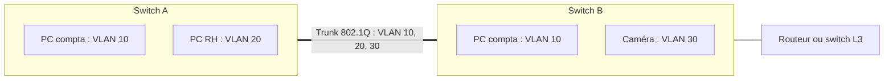

Deux VLAN ne communiquent qu'en passant par un routeur ou un switch de niveau 3 (routage inter-VLAN).

Le **routage inter-VLAN** se fait avec un routeur à sous-interfaces (« router-on-a-stick ») ou, plus souvent, avec un switch L3 et des interfaces virtuelles **SVI**.

### STP : éviter les boucles

Si l'on relie deux switchs par deux câbles, les broadcasts tournent en boucle et saturent le réseau (tempête de broadcast). Le **Spanning Tree Protocol** désigne un pont racine, calcule un arbre sans boucle et met en attente (blocage) les liens redondants, prêts à reprendre en cas de panne.

| Variante | Norme | Particularité |
| --- | --- | --- |
| STP | 802.1D | Convergence lente (30 à 50 s) |
| RSTP | 802.1w | Convergence en quelques secondes, standard actuel |
| MSTP | 802.1s | Plusieurs instances, regroupe des VLAN par arbre |

Autres fonctions de switch à connaître : **LACP** (802.3ad / 802.1AX) pour agréger plusieurs ports en un seul lien logique, **port security** (limiter les MAC par port), **DHCP snooping** et **Dynamic ARP Inspection** (contrer les faux serveurs et l'usurpation ARP), **QoS** (priorités), **LLDP** (découverte des voisins), **mirroring** (copie du trafic vers un analyseur).

## 05 Adressage IPv4

Une adresse IPv4 est un nombre de 32 bits, écrit en quatre octets décimaux : `192.168.10.25`. Elle comporte une partie **réseau** et une partie **hôte**. Le **masque de sous-réseau** (ou la notation CIDR `/24`) indique où se fait la coupure.

### Lire un masque

```
Adresse   192.168.10.25    = 11000000.10101000.00001010.00011001
Masque /24 255.255.255.0   = 11111111.11111111.11111111.00000000
                              |---- réseau (24 bits) ----|-hôte-|
Réseau    192.168.10.0     (adresse AND masque)
Broadcast 192.168.10.255   (tous les bits hôte à 1)
Hôtes     192.168.10.1 à 192.168.10.254  (254 adresses utilisables)
```

### Tableau de référence CIDR

| CIDR | Masque | Adresses | Hôtes utilisables | Usage courant |
| --- | --- | --- | --- | --- |
| /8 | 255.0.0.0 | 16 777 216 | 16 777 214 | Très grand réseau (10.0.0.0/8) |
| /16 | 255.255.0.0 | 65 536 | 65 534 | Grand site, VPC cloud |
| /20 | 255.255.240.0 | 4 096 | 4 094 | Campus |
| /24 | 255.255.255.0 | 256 | 254 | Réseau local classique |
| /25 | 255.255.255.128 | 128 | 126 | Demi-réseau |
| /26 | 255.255.255.192 | 64 | 62 | Petit service |
| /27 | 255.255.255.224 | 32 | 30 | Petit service |
| /28 | 255.255.255.240 | 16 | 14 | Serveurs, DMZ |
| /29 | 255.255.255.248 | 8 | 6 | Liaison avec quelques équipements |
| /30 | 255.255.255.252 | 4 | 2 | Lien point à point entre deux routeurs |
| /31 | 255.255.255.254 | 2 | 2 (RFC 3021) | Point à point, économie d'adresses |
| /32 | 255.255.255.255 | 1 | 1 | Une seule machine (loopback, route d'hôte) |

Formule : hôtes utilisables = 2(32 − préfixe) − 2 (on retire l'adresse de réseau et celle de broadcast).

### Plages réservées à connaître

| Plage | Rôle |
| --- | --- |
| 10.0.0.0/8 | Privée (RFC 1918) |
| 172.16.0.0/12 | Privée (de 172.16.0.0 à 172.31.255.255) |
| 192.168.0.0/16 | Privée |
| 100.64.0.0/10 | Espace CGNAT des opérateurs (RFC 6598) |
| 127.0.0.0/8 | Loopback, la machine elle-même (127.0.0.1) |
| 169.254.0.0/16 | APIPA / link-local : adresse auto-attribuée quand le DHCP ne répond pas |
| 224.0.0.0/4 | Multicast |
| 192.0.2.0/24, 198.51.100.0/24, 203.0.113.0/24 | Documentation et exemples |

Les anciennes « classes » A, B, C ne sont plus utilisées pour allouer des adresses : on parle de **CIDR** (Classless Inter-Domain Routing) avec des préfixes de longueur libre.

### Exemple de découpage

Tu disposes de `192.168.10.0/24` et tu veux 4 sous-réseaux égaux. Il faut emprunter 2 bits (2² = 4), donc passer de /24 à /26. Chaque bloc fait 64 adresses.

| Sous-réseau | Réseau | Plage utilisable | Broadcast |
| --- | --- | --- | --- |
| 1 | 192.168.10.0/26 | .1 à .62 | 192.168.10.63 |
| 2 | 192.168.10.64/26 | .65 à .126 | 192.168.10.127 |
| 3 | 192.168.10.128/26 | .129 à .190 | 192.168.10.191 |
| 4 | 192.168.10.192/26 | .193 à .254 | 192.168.10.255 |

#### Autre exemple : à quel réseau appartient 172.16.5.77/20 ?

Un /20 donne un bloc de 16 dans le 3e octet (256 − 240). Le multiple de 16 inférieur ou égal à 5 est 0, donc réseau `172.16.0.0/20`, broadcast `172.16.15.255`.

### VLSM : des masques de tailles différentes

Le **VLSM** (Variable Length Subnet Mask) attribue à chaque réseau un masque adapté à ses besoins : on alloue d'abord les plus gros besoins, puis les plus petits. Exemple : 100 postes (/25), 50 postes (/26), 10 serveurs (/28), liens routeurs (/30).

Méthode pour toute question d'adressage

1. Calcule le nombre d'hôtes nécessaires, ajoute 2 et prends la puissance de 2 supérieure.
2. Déduis le préfixe : 32 − nombre de bits d'hôtes.
3. Trouve la taille de bloc (256 − valeur de l'octet du masque) et aligne les réseaux sur ce bloc.

Le plan d'adressage doit aussi prévoir la croissance : garde de la marge et regroupe les blocs par site ou par fonction pour pouvoir résumer les routes.

## 06 IPv6

IPv4 offre environ 4,3 milliards d'adresses, épuisées depuis les années 2010 à l'échelle des registres. **IPv6** utilise 128 bits, soit 3,4 × 1038 adresses. Son déploiement progresse régulièrement : une part importante du trafic des grands services mondiaux l'utilise désormais, avec de fortes différences selon les pays et les opérateurs.

### Écriture

```
2001:0db8:0000:0000:0000:0000:0000:0001
Règle 1 : on supprime les zéros de tête de chaque groupe  → 2001:db8:0:0:0:0:0:1
Règle 2 : une seule suite de groupes à zéro devient ::    → 2001:db8::1
```

Un réseau local reçoit presque toujours un préfixe **/64** : 64 bits de réseau, 64 bits d'identifiant d'interface. Un site reçoit en général un /48 ou un /56 de son fournisseur.

### Types d'adresses

| Type | Préfixe | Rôle |
| --- | --- | --- |
| Global unicast (GUA) | 2000::/3 | Adresse publique routable sur Internet |
| Link-local | fe80::/10 | Valable sur le lien seulement, présente sur toute interface IPv6 |
| Unique local (ULA) | fc00::/7 (fd00::/8 en pratique) | Équivalent des adresses privées |
| Multicast | ff00::/8 | Groupes (remplace le broadcast, qui n'existe plus) |
| Loopback | ::1 | La machine elle-même |
| Documentation | 2001:db8::/32 | Exemples |

### Configuration automatique

- **SLAAC** : la machine écoute les annonces de routeur (RA) qui donnent le préfixe, puis fabrique son adresse seule. Les systèmes modernes utilisent des identifiants aléatoires et temporaires pour la vie privée.
- **DHCPv6** : attribution gérée, ou informations complémentaires (DNS).
- **NDP** (Neighbor Discovery) remplace ARP et inclut la découverte des routeurs.

### IPv4 contre IPv6

| Critère | IPv4 | IPv6 |
| --- | --- | --- |
| Taille | 32 bits | 128 bits |
| Notation | Décimale pointée | Hexadécimale avec « : » |
| Broadcast | Oui | Non (multicast) |
| Résolution adresse/MAC | ARP | NDP (ICMPv6) |
| NAT | Très répandu | Inutile en principe (adresses publiques de bout en bout) |
| Fragmentation | Par les routeurs | Par l'émetteur seulement |
| En-tête | Taille variable, 20 octets minimum | Taille fixe de 40 octets |

Pendant la transition, on utilise la **double pile** (IPv4 et IPv6 en parallèle), des tunnels, et des mécanismes comme **NAT64 / DNS64** pour atteindre des services IPv4 depuis un réseau IPv6 seul. L'absence de NAT ne supprime pas le besoin d'un pare-feu : c'est lui qui protège, pas la traduction d'adresse.

## 07 Routage, ICMP et NAT

Le **routeur** relie des réseaux différents. Pour chaque paquet, il regarde l'adresse IP de destination, cherche la **route la plus spécifique** (préfixe le plus long) dans sa table de routage et transmet au prochain saut (next hop).

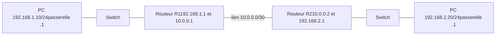

Pour joindre 192.168.2.20, PC1 envoie à sa passerelle (R1) ; R1 consulte sa table et transmet à R2.

### Lire une table de routage

```
Destination        Masque   Prochain saut   Interface   Origine
192.168.1.0        /24      directement     eth0        connectée
192.168.2.0        /24      10.0.0.2        eth1        statique ou dynamique
0.0.0.0            /0       203.0.113.1     eth2        route par défaut (vers Internet)
```

La **route par défaut** `0.0.0.0/0` sert quand rien de plus précis ne correspond. Quand plusieurs sources proposent la même destination, la **distance administrative** départage : la plus basse gagne.

### Routage statique et dynamique

- **Statique** : saisi à la main. Simple, prévisible, adapté aux petits réseaux et aux routes par défaut. Ne s'adapte pas aux pannes.
- **Dynamique** : les routeurs échangent leurs informations avec un protocole et recalculent seuls les chemins.

| Protocole | Famille | Métrique / principe | Dist. admin. | Usage |
| --- | --- | --- | --- | --- |
| Connecté | - | Réseau directement relié | 0 | - |
| Statique | - | Manuel | 1 | Petits réseaux, défaut |
| eBGP | Path vector (EGP) | Chemin d'AS et politiques | 20 | Entre organisations, Internet |
| EIGRP | Hybride (Cisco) | Bande passante et délai | 90 | Réseaux d'entreprise Cisco |
| OSPF | État de liens (IGP) | Coût basé sur la bande passante | 110 | Standard des réseaux d'entreprise |
| IS-IS | État de liens (IGP) | Coût | 115 | Opérateurs, datacenters |
| RIP | Vecteur de distance | Nombre de sauts (max 15) | 120 | Obsolète, pédagogique |
| iBGP | Path vector | Politiques internes | 200 | Au sein d'un même AS |

- **IGP** (OSPF, IS-IS, EIGRP) : routage à l'intérieur d'un **système autonome** (AS).
- **EGP** : **BGP** relie les quelque 100 000 systèmes autonomes qui forment Internet. Il choisit selon des *politiques* (contrats, coûts), pas selon la vitesse. Une erreur BGP peut couper un service entier : c'est pourquoi on déploie **RPKI** pour valider l'origine des préfixes.

### TTL et ICMP

Chaque paquet IP porte un compteur **TTL** (Hop Limit en IPv6) décrémenté à chaque routeur. À zéro, le paquet est détruit, ce qui évite les boucles infinies. Le routeur renvoie alors un message **ICMP** « Time Exceeded ». C'est ainsi que `traceroute` découvre le chemin : il envoie des paquets avec un TTL croissant (1, 2, 3...).

| Message ICMP | Signification |
| --- | --- |
| Echo Request / Reply | Le `ping` |
| Destination Unreachable | Réseau, hôte, protocole ou port injoignable |
| Time Exceeded | TTL expiré (traceroute) |
| Fragmentation Needed | Paquet trop gros avec le bit DF : base de la découverte du PMTU |

### NAT et PAT

Le **NAT** traduit des adresses privées en adresses publiques à la sortie d'un réseau. Le **PAT** (ou NAT overload), utilisé par toutes les box Internet, partage *une seule* adresse publique entre de nombreuses machines en distinguant les connexions par le numéro de port source.

| Avant NAT (côté LAN) | Après NAT (côté Internet) |
| --- | --- |
| 192.168.1.10:51000 → 93.184.216.34:443 | 203.0.113.5:40001 → 93.184.216.34:443 |
| 192.168.1.11:51000 → 93.184.216.34:443 | 203.0.113.5:40002 → 93.184.216.34:443 |

- **SNAT** : change l'adresse source (sortie). **DNAT / redirection de port** : change l'adresse destination pour exposer un service interne.
- Les opérateurs utilisent le **CGNAT** : plusieurs abonnés partagent une même IPv4 publique. Cela complique l'hébergement chez soi et motive IPv6.
- Le NAT n'est pas un mécanisme de sécurité, seulement un effet de bord.

## 08 Transport : TCP, UDP, QUIC

La couche 4 relie des **programmes** et non des machines. Elle utilise les **ports** (0 à 65 535) : une connexion est identifiée par IP source, port source, IP destination, port destination et protocole.

| Plage de ports | Nom | Usage |
| --- | --- | --- |
| 0 à 1023 | Bien connus | Services standards (80, 443, 22...) |
| 1024 à 49151 | Enregistrés | Applications (3306 MySQL, 5432 PostgreSQL) |
| 49152 à 65535 | Dynamiques / éphémères | Ports source choisis par les clients |

### TCP contre UDP

| Critère | TCP | UDP |
| --- | --- | --- |
| Connexion | Oui (établissement et fermeture) | Non |
| Fiabilité | Accusés de réception, retransmission | Aucune garantie |
| Ordre | Garanti | Non garanti |
| Contrôle de flux et de congestion | Oui | Non |
| En-tête | 20 octets minimum | 8 octets |
| Usages | Web, mail, SSH, fichiers, bases de données | DNS, DHCP, VoIP, visio, jeux, streaming, VPN WireGuard |

### Établissement d'une connexion TCP

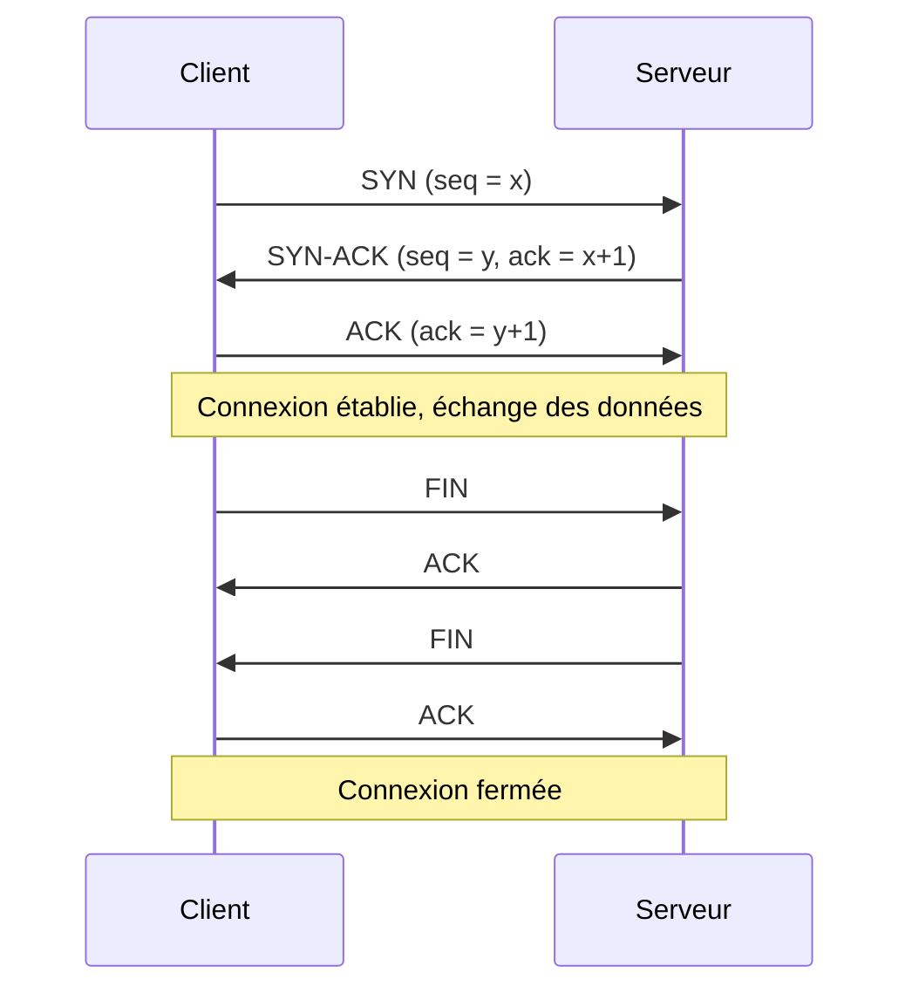

Poignée de main en trois temps (three-way handshake), puis fermeture en quatre messages.

### Mécanismes de TCP

- **Numéros de séquence et d'acquittement** : chaque octet est numéroté, le récepteur confirme ce qu'il a reçu.
- **Fenêtre glissante** : le récepteur annonce combien de données il peut accepter (contrôle de flux).
- **Contrôle de congestion** : démarrage lent (slow start), puis croissance prudente, réduction à la moindre perte. Algorithmes courants : CUBIC, BBR.
- **Retransmission** sur délai dépassé ou sur trois ACK dupliqués (fast retransmit).
- **MSS** : taille maximale d'un segment, négociée à l'ouverture (1 460 octets pour un MTU de 1 500).

#### Drapeaux TCP

| Drapeau | Rôle |
| --- | --- |
| SYN | Ouvre la connexion, synchronise les numéros |
| ACK | Accuse réception |
| FIN | Ferme proprement |
| RST | Coupe brutalement (port fermé, erreur) |
| PSH | Demande de livrer sans attendre à l'application |

### QUIC

**QUIC** (RFC 9000) fonctionne au-dessus d'UDP et intègre le chiffrement TLS 1.3. Il établit une connexion en un aller-retour (voire zéro en reprise), évite le blocage de tête de file entre flux et survit à un changement de réseau (Wi-Fi vers 4G). C'est le transport de **HTTP/3**, déjà très répandu sur les grands sites.

## 09 DNS et DHCP

### DNS : l'annuaire d'Internet

Le **DNS** traduit un nom (`www.exemple.fr`) en adresse IP. C'est une base de données distribuée et hiérarchique : racine (`.`), domaines de premier niveau (`.fr`, `.com`), puis les domaines des organisations.

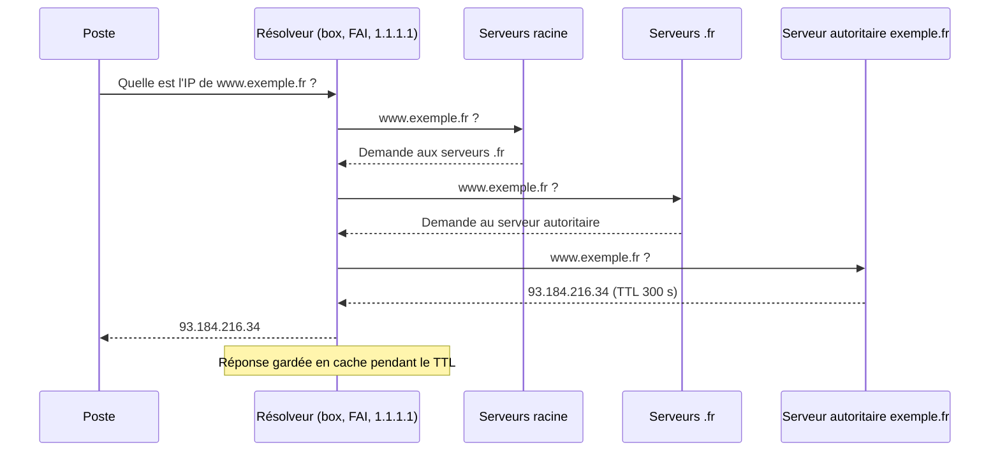

Résolution récursive : le résolveur interroge la hiérarchie et met le résultat en cache.

| Enregistrement | Rôle | Exemple |
| --- | --- | --- |
| A | Nom vers IPv4 | www → 93.184.216.34 |
| AAAA | Nom vers IPv6 | www → 2001:db8::1 |
| CNAME | Alias vers un autre nom | blog → www |
| MX | Serveurs de messagerie du domaine | 10 mail.exemple.fr |
| NS | Serveurs de noms faisant autorité | ns1.exemple.fr |
| TXT | Texte : SPF, DKIM, DMARC, vérifications | v=spf1 ... |
| PTR | Résolution inverse (IP vers nom) | 34.216.184.93.in-addr.arpa |
| SRV | Localisation d'un service (hôte et port) | \_sip.\_tcp |
| SOA | Paramètres de la zone | Serial, durées |
| CAA | Autorités autorisées à émettre des certificats | 0 issue "letsencrypt.org" |

- Le DNS utilise surtout UDP/53, et TCP/53 pour les grosses réponses et les transferts de zone.
- **DNSSEC** signe les réponses pour garantir leur authenticité. **DoT** (853) et **DoH** (443) chiffrent la requête entre le poste et le résolveur.
- Le DNS est une cible d'attaque (empoisonnement de cache, amplification DDoS) et la cause de nombreuses pannes : « c'est toujours le DNS ».

### DHCP : la configuration automatique

Le **DHCP** donne à une machine qui se connecte une adresse IP, un masque, une passerelle, des serveurs DNS et une durée de bail (lease). Il utilise UDP (serveur 67, client 68). Étapes, en anglais « DORA » :

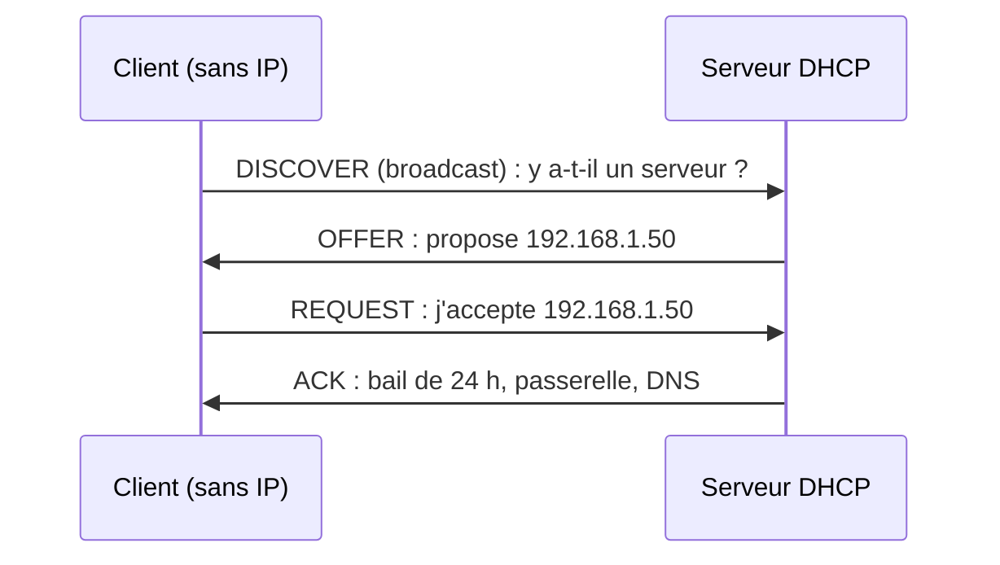

- Le bail est renouvelé à mi-durée (T1 = 50 %).
- Un **relais DHCP** (*ip helper*) transmet les requêtes d'un VLAN vers un serveur situé dans un autre réseau.
- Une **réservation** associe une adresse fixe à une MAC.
- Sans réponse, Windows et Linux s'attribuent une adresse 169.254.x.x : signe typique d'un problème DHCP.

## 10Web, HTTP et TLS

### Ce qui se passe quand tu tapes une adresse

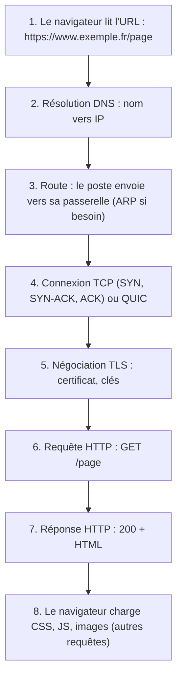

### HTTP

HTTP est le protocole de requête et de réponse du web. Une requête comprend une **méthode**, un chemin, des en-têtes et éventuellement un corps.

```
GET /produits?id=42 HTTP/1.1
Host: www.exemple.fr
Accept: text/html

HTTP/1.1 200 OK
Content-Type: text/html
Cache-Control: max-age=3600
```

| Méthode | Usage |
| --- | --- |
| GET | Lire une ressource |
| POST | Envoyer des données, créer |
| PUT / PATCH | Remplacer / modifier |
| DELETE | Supprimer |
| HEAD / OPTIONS | En-têtes seuls / options autorisées (CORS) |

| Code | Sens | Cause courante |
| --- | --- | --- |
| 200 OK | Succès | - |
| 301 / 302 | Redirection permanente / temporaire | Changement d'URL, passage en HTTPS |
| 304 | Non modifié | Cache valide |
| 400 | Requête invalide | Syntaxe erronée |
| 401 / 403 | Non authentifié / interdit | Identifiants manquants / droits insuffisants |
| 404 | Introuvable | Mauvaise URL |
| 429 | Trop de requêtes | Limitation de débit |
| 500 | Erreur serveur | Bug applicatif |
| 502 / 504 | Mauvaise passerelle / délai dépassé | Proxy ou répartiteur ne joint pas l'amont |
| 503 | Service indisponible | Surcharge, maintenance |

| Version | Transport | Apport |
| --- | --- | --- |
| HTTP/1.1 | TCP | Connexions persistantes, texte lisible |
| HTTP/2 | TCP + TLS | Multiplexage de requêtes sur une connexion, compression d'en-têtes |
| HTTP/3 | QUIC (UDP) | Plus de blocage de tête de file TCP, connexion rapide, mobilité |

### TLS et HTTPS

**TLS** chiffre la communication, authentifie le serveur et garantit l'intégrité. Version actuelle recommandée : **TLS 1.3** (TLS 1.0 et 1.1 sont abandonnés). L'authentification repose sur des **certificats X.509** signés par des autorités de certification (AC), selon une chaîne de confiance : certificat du site, AC intermédiaire, AC racine présente dans le navigateur.

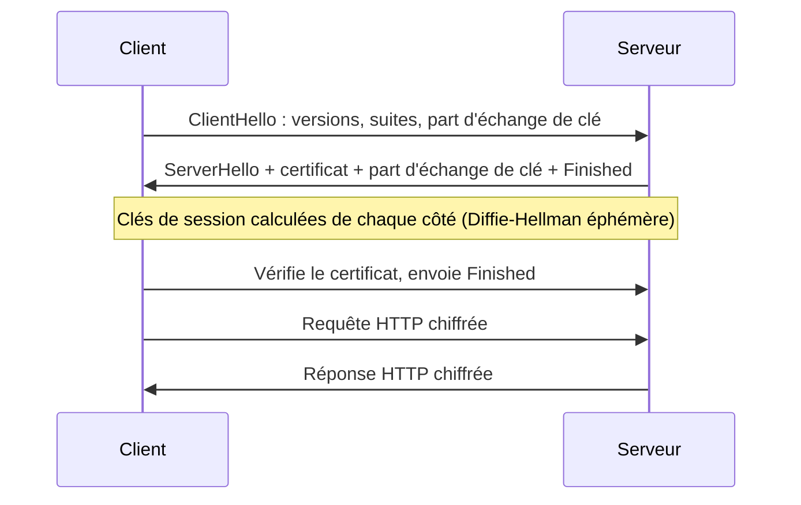

Négociation TLS 1.3 : un seul aller-retour avant d'envoyer les données.

- Le chiffrement des données utilise une clé **symétrique** (rapide, comme AES-GCM ou ChaCha20), obtenue par échange de clés **asymétrique** éphémère (confidentialité persistante).
- Les certificats sont gratuits et automatisables (protocole ACME, Let's Encrypt) et ont des durées de validité de plus en plus courtes.
- **HSTS** force le navigateur à n'utiliser que HTTPS. **mTLS** authentifie aussi le client (API, Zero Trust).

### Proxys et répartiteurs de charge

- **Proxy direct** : intermédiaire pour les clients d'un réseau (filtrage, cache).
- **Reverse proxy** : devant les serveurs (Nginx, HAProxy, Envoy), il termine TLS, répartit la charge et protège.
- **CDN** : serveurs de cache répartis dans le monde, rapprochés des utilisateurs (anycast).
- **Load balancer L4** (répartit selon IP et port) ou **L7** (selon l'URL, les en-têtes, les cookies).

## 11 Autres services et ports

| Service | Port | Transport | Rôle et remarque |
| --- | --- | --- | --- |
| FTP | 20, 21 | TCP | Transfert de fichiers en clair, à éviter |
| SSH / SFTP / SCP | 22 | TCP | Administration à distance chiffrée, transfert de fichiers sûr |
| Telnet | 23 | TCP | Administration en clair, obsolète |
| SMTP | 25 / 587 / 465 | TCP | Envoi et relais de courriers (587 avec STARTTLS, 465 TLS direct) |
| DNS | 53 | UDP/TCP | Résolution de noms |
| DHCP | 67 / 68 | UDP | Attribution d'adresses |
| HTTP | 80 | TCP | Web non chiffré |
| POP3 / POP3S | 110 / 995 | TCP | Récupération du courrier (télécharge) |
| NTP | 123 | UDP | Synchronisation de l'heure |
| IMAP / IMAPS | 143 / 993 | TCP | Courrier synchronisé sur le serveur |
| SNMP | 161 / 162 | UDP | Supervision (utiliser SNMPv3) |
| LDAP / LDAPS | 389 / 636 | TCP | Annuaire (Active Directory) |
| HTTPS | 443 | TCP (+UDP pour HTTP/3) | Web chiffré |
| SMB | 445 | TCP | Partage de fichiers Windows, ne jamais l'exposer sur Internet |
| Syslog | 514 | UDP/TCP | Centralisation des journaux |
| IKE / IPsec NAT-T | 500 / 4500 | UDP | VPN IPsec |
| OpenVPN | 1194 | UDP/TCP | VPN |
| MySQL / PostgreSQL | 3306 / 5432 | TCP | Bases de données |
| RDP | 3389 | TCP | Bureau à distance Windows, cible fréquente d'attaques |
| WireGuard | 51820 | UDP | VPN moderne (port par défaut) |

### Messagerie

L'utilisateur envoie son courrier par **SMTP** à son serveur, qui retrouve le serveur du destinataire grâce à l'enregistrement DNS **MX**, puis le dépose ; le destinataire le lit par **IMAP** (ou POP3). Contre l'usurpation d'expéditeur, trois mécanismes DNS se combinent : **SPF** (serveurs autorisés), **DKIM** (signature) et **DMARC** (politique à appliquer en cas d'échec).

### SSH

SSH remplace Telnet. Préfère l'authentification par **clé** au mot de passe, désactive la connexion de root directe, et utilise-le aussi pour des tunnels (`ssh -L`, `-D`) et le transfert de fichiers (`scp`, `sftp`).

### NTP

L'heure exacte est indispensable : certificats TLS, journaux corrélables, authentification Kerberos. Les équipements réseau doivent tous se synchroniser sur les mêmes sources fiables.

## 12Équipements réseau

| Équipement | Couche | Fonction | Remarque |
| --- | --- | --- | --- |
| Répéteur / hub | 1 | Répète le signal sur tous les ports | Obsolète, un seul domaine de collision |
| Switch L2 | 2 | Commute par adresse MAC, VLAN | Un domaine de collision par port |
| Switch L3 | 2-3 | Commute et route entre VLAN à très haut débit | Cœur de réseau d'entreprise |
| Routeur | 3 | Relie des réseaux, routage, NAT | Sépare les domaines de broadcast |
| Point d'accès Wi-Fi (AP) | 1-2 | Fait le pont entre Wi-Fi et Ethernet | Géré par un contrôleur ou le cloud |
| Pare-feu | 3-7 | Filtre le trafic selon des règles | Voir chapitre 14 |
| Load balancer | 4-7 | Répartit les requêtes entre serveurs | Vérifie l'état de santé des serveurs |
| Proxy / reverse proxy | 7 | Intermédiaire applicatif | Cache, filtrage, terminaison TLS |
| Modem / ONT | 1 | Adapte le signal de l'opérateur (ADSL, fibre FTTH, câble) | L'ONT termine la fibre optique |
| IDS / IPS | 3-7 | Détecte / bloque les attaques | Souvent intégré au pare-feu |
| Box Internet | 1-7 | Routeur, switch, Wi-Fi, DHCP, DNS, NAT et pare-feu dans un seul boîtier | Équipement domestique tout-en-un |

| Appareil | Domaines de collision | Domaines de broadcast |
| --- | --- | --- |
| Hub | 1 pour tous les ports | 1 |
| Switch | 1 par port | 1 par VLAN |
| Routeur | 1 par interface | 1 par interface |

## 13Wi-Fi et réseaux mobiles

### Les standards Wi-Fi (IEEE 802.11)

| Nom commercial | Norme | Bandes | Débit théorique max. | Points clés |
| --- | --- | --- | --- | --- |
| Wi-Fi 4 | 802.11n | 2,4 et 5 GHz | 600 Mb/s | MIMO |
| Wi-Fi 5 | 802.11ac | 5 GHz | 6,9 Gb/s | Canaux 80/160 MHz, MU-MIMO descendant |
| Wi-Fi 6 / 6E | 802.11ax | 2,4, 5 (et 6 GHz pour 6E) | 9,6 Gb/s | OFDMA, efficace en environnement dense |
| Wi-Fi 7 | 802.11be | 2,4, 5 et 6 GHz | 46 Gb/s | Canaux 320 MHz, 4096-QAM, Multi-Link Operation (MLO) |

Le Wi-Fi 7 se déploie depuis 2024 ; la norme suivante (802.11bn, orientée fiabilité) est en cours d'élaboration. Les débits réels sont bien inférieurs aux valeurs théoriques : compte une fraction de ce chiffre, partagée entre tous les appareils d'une même cellule.

### Bandes de fréquences

| Bande | Portée et traversée des murs | Débit | Encombrement |
| --- | --- | --- | --- |
| 2,4 GHz | La meilleure | Faible | Fort (Bluetooth, micro-ondes). Seulement 3 canaux sans recouvrement : 1, 6, 11 |
| 5 GHz | Moyenne | Élevé | Moyen, nombreux canaux (certains partagés avec les radars, règle DFS) |
| 6 GHz | Plus courte | Très élevé | Faible, canaux larges, WPA3 obligatoire |

### Notions essentielles

- **SSID** : nom du réseau. **BSSID** : adresse MAC de la radio de l'AP. **ESS** : plusieurs AP qui partagent un SSID.
- **CSMA/CA** : on écoute avant d'émettre, car on ne peut pas détecter les collisions en radio. Le Wi-Fi est **half-duplex** et partagé : plus il y a d'appareils actifs, moins chacun a de débit.
- **Roaming** : passer d'un AP à un autre sans coupure (standards 802.11k, v, r).
- **Mesh** : AP qui se relaient entre eux. Le câblage Ethernet entre bornes (backhaul filaire) est toujours préférable.
- **Site survey** : étude de couverture et de capacité avant le déploiement.

### Sécurité Wi-Fi

| Protocole | État | Remarque |
| --- | --- | --- |
| WEP | Cassé | Ne jamais utiliser |
| WPA / TKIP | Obsolète | Faible |
| WPA2-Personnel (PSK, AES-CCMP) | Encore courant | Mot de passe partagé, sensible aux attaques par dictionnaire hors ligne |
| WPA3-Personnel (SAE) | Recommandé | Résiste aux dictionnaires hors ligne, confidentialité persistante |
| WPA2/WPA3-Entreprise (802.1X, EAP) | Référence en entreprise | Identifiants individuels via un serveur RADIUS |
| Wi-Fi Enhanced Open (OWE) | Réseaux ouverts | Chiffre sans mot de passe |

Désactive le WPS, utilise une phrase de passe longue, sépare un SSID « invités » dans un VLAN isolé, et mets à jour le micrologiciel des bornes.

### Réseaux mobiles

| Génération | Technologie | Débit indicatif | Apport |
| --- | --- | --- | --- |
| 2G | GSM | quelques dizaines de kb/s | Voix numérique, SMS |
| 3G | UMTS / HSPA | jusqu'à quelques Mb/s | Internet mobile |
| 4G | LTE | dizaines à centaines de Mb/s | Tout IP, voix sur IP (VoLTE) |
| 5G | NR (New Radio) | centaines de Mb/s à plusieurs Gb/s | Faible latence, forte densité, network slicing, versions « standalone » avec cœur 5G natif |

Autres technologies sans fil : **Bluetooth** et **BLE** (courte portée), **Zigbee, Thread, Matter** (domotique), **LoRaWAN** et **NB-IoT** (objets connectés longue portée, faible débit), **NFC** (quelques centimètres).

## 14Sécurité réseau

### Les objectifs : le triangle CIA

- **Confidentialité** : seuls les autorisés lisent (chiffrement, contrôle d'accès).
- **Intégrité** : les données ne sont pas modifiées (hachage, signatures).
- **Disponibilité** : le service reste accessible (redondance, anti-DDoS, sauvegardes).

S'y ajoutent l'**authentification** (qui es-tu ?), l'**autorisation** (que peux-tu faire ?) et la **traçabilité** (journaux). Principes directeurs : **défense en profondeur** (plusieurs barrières successives), **moindre privilège** et **segmentation**.

### Principales attaques et parades

| Attaque | Principe | Parades |
| --- | --- | --- |
| Sniffing | Écouter le trafic non chiffré | TLS, VPN, switchs plutôt que hubs, 802.1X |
| ARP spoofing / MITM | Se faire passer pour la passerelle sur le LAN | Dynamic ARP Inspection, segmentation, chiffrement de bout en bout |
| Faux serveur DHCP | Distribuer de fausses passerelles ou DNS | DHCP snooping |
| VLAN hopping | Sauter d'un VLAN à l'autre (double étiquetage, négociation de trunk) | Désactiver DTP, VLAN natif inutilisé, ports en accès fixe |
| MAC flooding | Saturer la table CAM pour que le switch inonde | Port security |
| Empoisonnement DNS | Falsifier une réponse DNS | DNSSEC, DoT / DoH, résolveurs à jour |
| DoS / DDoS | Saturer un service (volumétrique, SYN flood, amplification) | Filtrage en amont, CDN anti-DDoS, SYN cookies, limitation de débit |
| Balayage de ports | Chercher des services ouverts | Pare-feu, fermer les ports inutiles, IDS |
| Hameçonnage | Tromper l'utilisateur | Formation, SPF/DKIM/DMARC, MFA, passkeys |
| Rançongiciel et mouvement latéral | Chiffrer et se propager de machine en machine | Segmentation, sauvegardes hors ligne, EDR, moindre privilège |
| Point d'accès pirate (evil twin) | Faux Wi-Fi imitant le vrai | 802.1X avec validation du certificat, WIPS, VPN |
| Détournement BGP | Annoncer des préfixes qui ne sont pas les siens | RPKI, filtrage des annonces |

### Pare-feu

| Génération | Ce qu'il examine |
| --- | --- |
| Filtre de paquets (ACL) | IP, protocole, port, paquet par paquet, sans mémoire |
| Stateful | Suit l'état des connexions : le retour d'un flux autorisé passe automatiquement |
| NGFW (nouvelle génération) | Applications, utilisateurs, IPS intégré, inspection TLS, filtrage d'URL, réputation |
| WAF | Spécialisé pour le web (injection SQL, XSS) |

Règles d'or : **refuser par défaut**, n'autoriser que le nécessaire, de la manière la plus précise possible, et documenter chaque règle. Les règles s'évaluent *dans l'ordre* : la première correspondance s'applique.

```
#  Source          Destination     Service   Action
1  Internet        Serveur web     TCP/443   Autoriser
2  LAN utilisateurs Internet       TCP/80,443, UDP/53   Autoriser
3  LAN utilisateurs DMZ            TCP/443   Autoriser
4  Tout            Tout            Tout      Refuser et journaliser
```

### VPN

Un **VPN** crée un tunnel chiffré à travers un réseau non sûr.

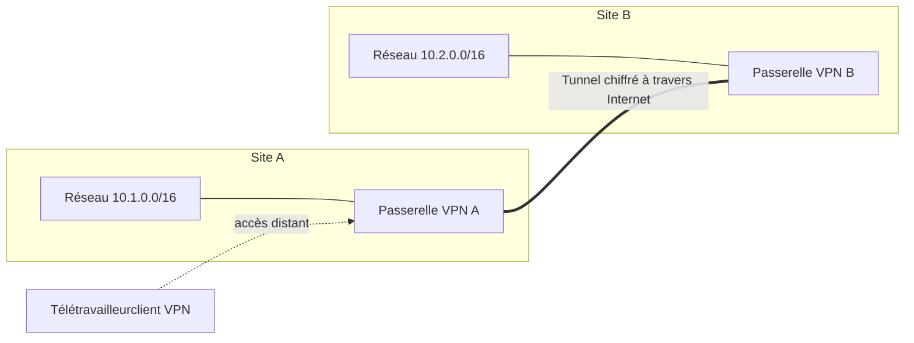

| Technologie | Usage | Remarque |
| --- | --- | --- |
| IPsec (IKEv2) | Site à site, accès distant | Standard universel, plus complexe |
| WireGuard | Site à site, accès distant, mesh | Moderne, très léger, code court et facile à auditer |
| OpenVPN | Accès distant | Très répandu, flexible |
| VPN SSL / TLS d'appliance | Accès distant | Passe par les pare-feu, surveille bien les mises à jour : cible fréquente |

Un VPN de site à site relie deux réseaux, un VPN d'accès distant relie un poste à un réseau. *Full tunnel* envoie tout le trafic dans le VPN, *split tunnel* seulement celui destiné à l'entreprise.

### Segmentation, DMZ et contrôle d'accès

- **DMZ** : zone intermédiaire qui héberge les services exposés (web, mail), isolée du réseau interne. Si un serveur est compromis, l'attaquant n'accède pas directement au LAN.
- **Micro-segmentation** : règles fines entre charges de travail, surtout en datacenter et cloud.
- **802.1X / NAC** : un appareil doit s'authentifier avant d'obtenir l'accès au port ou au Wi-Fi, via un serveur **RADIUS**.
- **AAA** : Authentication, Authorization, Accounting (RADIUS, TACACS+ pour l'administration des équipements).
- **IDS / IPS** : détection (alerte) et prévention (blocage) selon des signatures ou des anomalies.
- **SIEM** : collecte et corrèle les journaux de tous les équipements.

### Zero Trust

Le modèle classique « château fort » fait confiance à tout ce qui est à l'intérieur. Le **Zero Trust** part du principe inverse : aucune confiance implicite, chaque accès est vérifié selon l'identité, l'état du poste et le contexte, avec des droits minimaux. Il s'appuie sur l'authentification multifacteur (de préférence résistante à l'hameçonnage : passkeys, clés FIDO2), la micro-segmentation et l'accès par application (ZTNA) plutôt que par réseau complet. Les offres **SASE** regroupent SD-WAN et sécurité dans le cloud.

Bonnes pratiques de base

- Change les mots de passe par défaut, active MFA partout où c'est possible.
- Mets à jour systèmes et micrologiciels : la plupart des intrusions exploitent des failles connues.
- Désactive les services et ports inutiles (Telnet, SMBv1, WPS).
- Utilise SSH et HTTPS, jamais leurs équivalents en clair.
- Sépare les réseaux : utilisateurs, serveurs, invités, IoT, administration.
- Sauvegarde selon la règle 3-2-1 et teste la restauration.
- Centralise et surveille les journaux.

## 15Architecture de réseau

### Modèle hiérarchique à trois niveaux

Pour un campus ou un siège, on sépare trois rôles : **accès** (les prises et le Wi-Fi), **distribution** (agrégation, politiques, routage inter-VLAN) et **cœur** (transport rapide). Dans les sites moyens, on fusionne distribution et cœur : c'est le « cœur réduit » à deux niveaux.

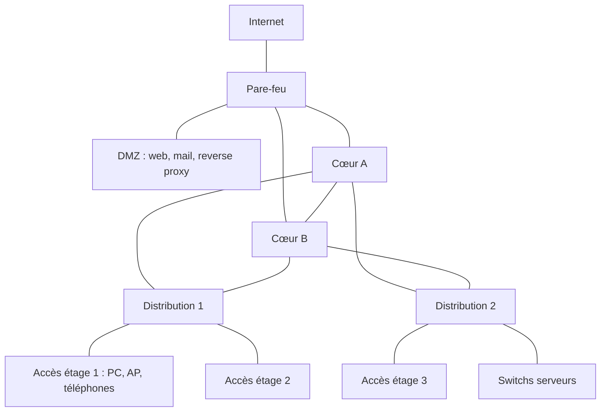

Chaque niveau est doublé pour supprimer les points uniques de panne.

### Spine-leaf pour le datacenter

Dans le datacenter, la plupart du trafic circule entre serveurs (« est-ouest »). L'architecture **spine-leaf** relie chaque switch de feuille (leaf) à chaque switch d'épine (spine) : tout serveur est à deux sauts de n'importe quel autre, avec des chemins multiples utilisés simultanément (ECMP).

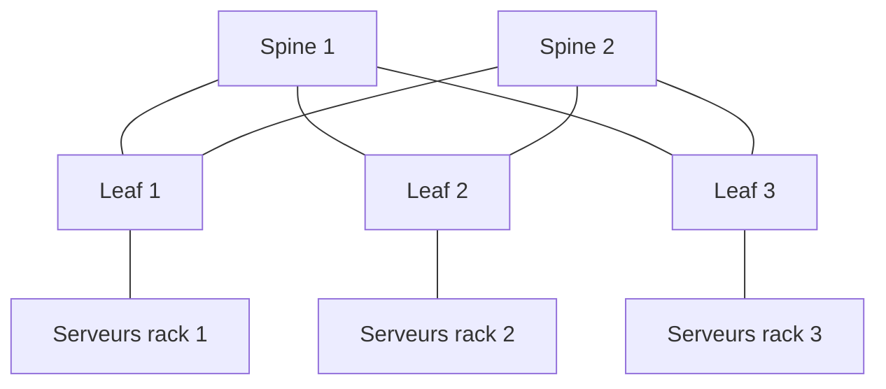

### Principes de conception

| Principe | Application |
| --- | --- |
| Redondance | Doubler liens, équipements et alimentations ; éviter tout point unique de panne |
| Haute disponibilité de la passerelle | VRRP, HSRP ou GLBP : une adresse IP virtuelle partagée par deux routeurs |
| Évolutivité | Plan d'adressage hiérarchique, résumé de routes |
| Segmentation | VLAN, VRF, zones de pare-feu |
| Simplicité | Standardiser les modèles de configuration, limiter les exceptions |
| Gestion | Réseau d'administration séparé (out-of-band), sauvegarde des configs, automatisation |
| Surabonnement (oversubscription) | Dimensionner les liens montants selon le trafic réel |

La documentation fait partie de la conception : schéma logique et physique, plan d'adressage, tableau des VLAN, matrice de flux, inventaire.

### Exemple de plan d'adressage d'une PME

| Zone | VLAN | Réseau | Passerelle |
| --- | --- | --- | --- |
| Administration équipements | 10 | 10.10.10.0/24 | 10.10.10.1 |
| Postes utilisateurs | 20 | 10.10.20.0/23 | 10.10.20.1 |
| Serveurs | 30 | 10.10.30.0/24 | 10.10.30.1 |
| Téléphonie IP | 40 | 10.10.40.0/24 | 10.10.40.1 |
| Wi-Fi invités | 50 | 10.10.50.0/24 | 10.10.50.1 |
| IoT, caméras | 60 | 10.10.60.0/24 | 10.10.60.1 |
| DMZ | 70 | 10.10.70.0/28 | 10.10.70.1 |

## 16Cloud, virtualisation, SDN et SD-WAN

### Réseau dans le cloud

Chez les grands fournisseurs (AWS, Azure, Google Cloud), le réseau est défini par logiciel. Les concepts se retrouvent d'un fournisseur à l'autre :

| Concept | Rôle |
| --- | --- |
| VPC / VNet | Réseau virtuel privé avec sa plage CIDR (par exemple 10.0.0.0/16) |
| Sous-réseau public / privé | Public : route vers l'Internet gateway. Privé : sortie par une passerelle NAT, pas d'accès entrant direct |
| Table de routage | Détermine où va le trafic de chaque sous-réseau |
| Security group | Pare-feu stateful attaché à une machine ou une interface |
| Network ACL | Filtre stateless au niveau du sous-réseau |
| Peering / Transit gateway | Interconnexion de VPC entre eux ou avec le réseau d'entreprise |
| VPN / Direct Connect / ExpressRoute | Liaison sécurisée ou dédiée entre site et cloud |
| Load balancer | Répartition L4 ou L7 entre instances |
| Endpoints privés | Accès aux services du fournisseur sans passer par Internet |

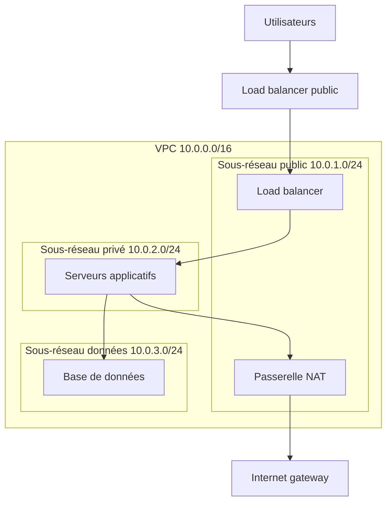

Architecture type trois niveaux dans un VPC : seul le répartiteur est exposé.

### Virtualisation et conteneurs

- **Switch virtuel** (vSwitch, Open vSwitch) : relie les machines virtuelles d'un hôte au réseau physique.
- **Conteneurs** (Docker, Kubernetes) : chaque pod reçoit une adresse IP ; le réseau est géré par un plugin **CNI** (Cilium, Calico). Les *Services* et *Ingress* exposent les applications, les *NetworkPolicies* filtrent les flux.
- **Overlay** : **VXLAN** encapsule des trames de niveau 2 dans de l'UDP pour étendre des réseaux logiques sur une infrastructure routée (jusqu'à 16 millions de segments, contre 4 094 VLAN). **EVPN** est le plan de contrôle associé en datacenter.

### SDN : réseau défini par logiciel

Le **SDN** sépare le *plan de contrôle* (décide où envoyer) du *plan de données* (envoie réellement). Un contrôleur centralisé programme les équipements via des API (OpenFlow, NETCONF/YANG, gNMI, REST). Il rend le réseau automatisable et reproductible.

#### Automatisation (NetDevOps)

- Outils : Ansible, Terraform, Python (Netmiko, NAPALM, Nornir).
- **Infrastructure as Code** : la configuration est un fichier versionné (Git), relu, testé puis déployé.
- Télémétrie en continu (streaming) plutôt que simple scrutation SNMP.

### SD-WAN et SASE

Le **SD-WAN** pilote de façon centralisée les liaisons des sites distants et choisit dynamiquement le meilleur chemin (fibre, 4G/5G, Internet) pour chaque application selon la qualité mesurée. Il remplace souvent les liaisons MPLS coûteuses. Le **SASE** y associe la sécurité fournie depuis le cloud (pare-feu, passerelle web, ZTNA).

### Autres notions modernes

- **CDN et Edge computing** : rapprocher contenu et calcul de l'utilisateur.
- **IoT** : milliers d'objets peu sécurisés, à isoler dans leur propre segment.
- **Wi-Fi 7, 5G privée** : sans fil à haute performance pour sites industriels.
- **Réseaux pour l'IA** : fabrics Ethernet 400/800G sans perte (RoCE) ou InfiniBand, pour relier des milliers d'accélérateurs de calcul.
- **Cryptographie post-quantique** : migration progressive des échanges de clés (TLS, VPN) vers des algorithmes résistants aux futurs ordinateurs quantiques, déjà proposés dans certains navigateurs et services.

## 17Supervision et dépannage

### Méthode de dépannage

1. **Définir** le problème : qui, quoi, depuis quand, qu'est-ce qui a changé ?
2. **Délimiter** : un poste, un VLAN, un site, tout le monde ?
3. **Hypothèses** puis **tests**, une variable à la fois.
4. **Corriger**, vérifier, **documenter**.

Trois approches : de bas en haut (couche 1 vers 7), de haut en bas, ou « diviser pour régner » en commençant par la couche 3 avec un ping.

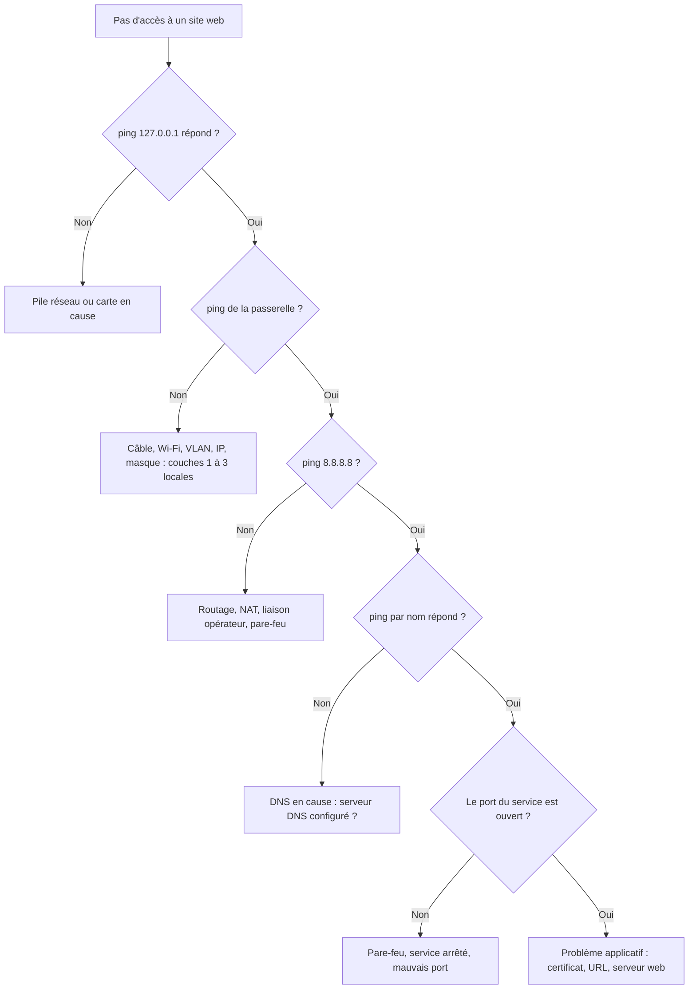

### Commandes essentielles

| Besoin | Windows | Linux / macOS |
| --- | --- | --- |
| Voir sa configuration IP | ipconfig /all | ip addr, ip route |
| Tester la joignabilité | ping 8.8.8.8 | ping 8.8.8.8 |
| Chemin vers une destination | tracert exemple.fr | traceroute / mtr exemple.fr |
| Interroger le DNS | nslookup exemple.fr | dig exemple.fr |
| Connexions et ports en écoute | netstat -ano | ss -tulpn |
| Table ARP | arp -a | ip neigh |
| Renouveler le bail DHCP | ipconfig /renew | dhclient ou nmcli |
| Vider le cache DNS | ipconfig /flushdns | resolvectl flush-caches |
| Tester un port TCP | Test-NetConnection hôte -Port 443 | nc -vz hôte 443 |
| Requête HTTP | curl -I https://exemple.fr | curl -I https://exemple.fr |
| Capture de paquets | Wireshark | tcpdump -i eth0 port 53, Wireshark |
| Débit entre deux machines | iperf3 | iperf3 |
| Scan de ports (sur ton propre réseau) | nmap | nmap -sV hôte |

Légalité

Ne scanne et ne capture que des réseaux qui t'appartiennent ou pour lesquels tu as une autorisation écrite.

### Symptômes et causes probables

| Symptôme | Causes probables |
| --- | --- |
| Adresse 169.254.x.x | Serveur DHCP injoignable, mauvais VLAN, câble |
| Ping IP réussi, ping par nom échoué | DNS mal configuré ou en panne |
| Accès à un réseau local mais pas à Internet | Passerelle absente ou fausse, NAT, route par défaut |
| Deux machines avec la même IP | Conflit d'adresse : connexions intermittentes |
| Lenteurs générales | Saturation d'un lien, boucle, duplex incohérent, Wi-Fi encombré |
| Coupures périodiques sur le Wi-Fi | Interférences, roaming mal réglé, DHCP à bail court |
| Erreur de certificat | Date de la machine fausse, certificat expiré, nom incorrect, interception TLS |
| Paquets perdus en fin de chemin seulement | Souvent le routeur qui limite les réponses ICMP, pas une vraie perte |
| Grosses pages bloquées, petites passent | Problème de MTU / MSS, ICMP filtré |

### Supervision

- **SNMP** (v3 de préférence) et **télémétrie** : état et compteurs des équipements.
- **NetFlow / IPFIX / sFlow** : qui parle à qui, quel volume.
- **Syslog** et **SIEM** : journaux centralisés.
- Outils : Zabbix, Nagios, PRTG, Prometheus et Grafana, LibreNMS, ELK.
- Indicateurs clés : disponibilité, utilisation des liens, erreurs et pertes d'interface, latence, charge CPU des équipements.
- Surveille la **baseline** (valeurs normales) pour repérer les écarts.

## 18Parcours, certifications et glossaire

### Parcours d'apprentissage conseillé

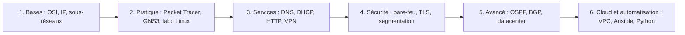

- **Pratique** : Cisco Packet Tracer (gratuit), GNS3, EVE-NG, Containerlab, machines virtuelles Linux, un vieux switch d'occasion.
- **Wireshark** : capture ton propre trafic (ping, DNS, handshake TCP, TLS) et relis les chapitres 8 à 10 avec les vraies trames.
- **RFC** : les textes officiels de l'IETF (793 TCP, 791 IP, 1918 adresses privées, 9000 QUIC, 8446 TLS 1.3).

| Certification | Niveau | Contenu |
| --- | --- | --- |
| CompTIA Network+ | Débutant, neutre vis-à-vis des éditeurs | Fondamentaux, services, sécurité, dépannage |
| Cisco CCNA | Débutant à intermédiaire | Commutation, routage, IP, Wi-Fi, automatisation, sécurité de base |
| Juniper JNCIA | Débutant | Fondamentaux sur l'écosystème Juniper |
| CompTIA Security+ | Intermédiaire | Sécurité générale |
| Cisco CCNP, CCIE | Avancé, expert | Entreprise, datacenter, sécurité, opérateur |
| AWS / Azure / Google (réseau) | Intermédiaire à avancé | Réseau cloud et hybride |
| Fortinet NSE, Palo Alto PCNSA | Variable | Pare-feu et sécurité réseau |

### Glossaire express

| Terme | Définition courte |
| --- | --- |
| ACL | Liste de règles autorisant ou refusant du trafic |
| AS | Système autonome : ensemble de réseaux sous une même politique de routage |
| Bail (lease) | Durée pendant laquelle une adresse DHCP est attribuée |
| Broadcast | Message envoyé à tous les appareils d'un segment |
| CIDR | Notation et allocation d'adresses avec préfixe de longueur variable |
| Domaine de broadcast | Ensemble des appareils qui reçoivent un même broadcast (un VLAN) |
| Gateway (passerelle) | Routeur qui sert de sortie d'un réseau local |
| Hôte | Machine connectée à un réseau |
| Latence | Temps de transit d'un paquet |
| MAC | Adresse physique de 48 bits d'une interface |
| MTU | Taille maximale d'un paquet sur un lien (1 500 octets en Ethernet) |
| Next hop | Prochain routeur sur le chemin |
| Passerelle par défaut | Destination des paquets vers d'autres réseaux |
| Port | Numéro identifiant un service ou une application sur une machine |
| QoS | Priorisation de certains flux (voix, vidéo) |
| Socket | Couple adresse IP et port : extrémité d'une connexion |
| Trunk | Lien transportant plusieurs VLAN |
| TTL | Compteur de sauts limitant la vie d'un paquet |
| VRF | Table de routage virtuelle : plusieurs réseaux isolés sur un même routeur |
| VRRP / HSRP | Protocoles de passerelle redondante à IP virtuelle |

### Fiche express : les dix réflexes

1. Un switch lit les **MAC**, un routeur lit les **IP**.
2. Un VLAN est un réseau IP distinct : il faut un routeur pour passer de l'un à l'autre.
3. Hôtes utilisables = 2n − 2 ; taille de bloc = 256 − octet du masque.
4. Le routeur choisit la route au **préfixe le plus long**.
5. TCP = fiable et ordonné ; UDP = rapide et sans garantie ; QUIC = UDP fiable et chiffré.
6. Quand quelque chose ne marche pas : câble, IP, passerelle, DNS, port, application.
7. Le NAT n'est pas un pare-feu.
8. Tout ce qui sort ou entre doit être chiffré (TLS, SSH, VPN).
9. Segmente, refuse par défaut, journalise.
10. Documente ce que tu construis.

Cours rédigé en octobre 2026. Les débits, versions de normes et parts de déploiement évoluent : pour un chiffre précis (adoption d'IPv6, nouvelles normes Wi-Fi ou Ethernet), vérifie la source officielle (IEEE, IETF, registres RIR) avant de t'y appuyer.
